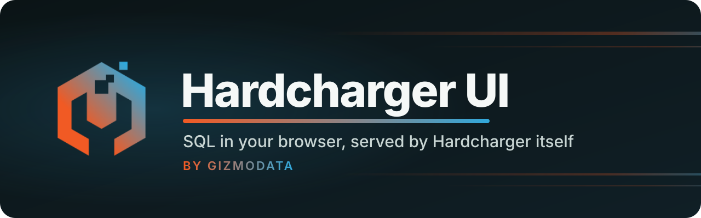
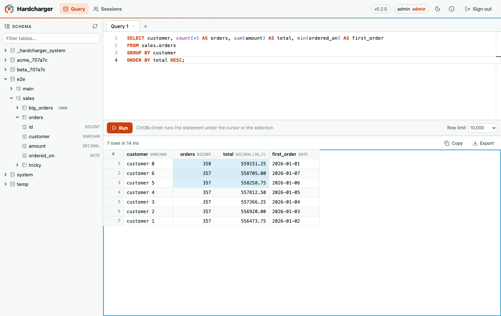

<p align="center">
  <a href="https://gizmodata.com">
    
  </a>
</p>

<p align="center">
  <a href="https://github.com/gizmodata/hardcharger-ui/actions/workflows/ci.yml"></a>
  <a href="https://github.com/gizmodata/hardcharger"></a>
  <a href="https://github.com/gizmodata/warp-sql"></a>
  <a href="https://arrow.apache.org"></a>
  
  
  <br>
  
  <a href="LICENSE"></a>
  <a href="https://join.slack.com/t/gizmodatacommunity/shared_invite/zt-42jk7kdti-SJp7qk7d6XYCIKfBG~4HrA"></a>
  <a href="https://gizmodata.com"></a>
</p>

<h3 align="center">Start the server, open <code>https://host:31337/ui</code>, write SQL.</h3>

---

## 🖥️ What is it?

**Hardcharger UI** is the web UI for [Hardcharger](https://github.com/gizmodata/hardcharger),
GizmoData's DuckDB 2.0 server. It is a static single-page app that the server itself serves at
`/ui`, on the same listener, origin and TLS certificate as its
[Warp SQL](https://github.com/gizmodata/warp-sql) endpoint. There is no Node backend and no
cross-origin access: the browser talks Warp SQL (plain HTTP and Apache Arrow) straight to the
server with [`@gizmodata/warp-sql`](https://github.com/gizmodata/warp-sql-js).



- ✍️ **SQL editor** (Monaco): Ctrl/⌘+Enter runs the statement under the cursor, or the
  selection; several tabs, each with its own server session, so one tab's long query never
  holds up another's.
- 📊 **Results grid** for up to a million rows (only the rows in view are drawn), with DuckDB's
  own formatting of decimals, dates, timestamps, intervals, lists, structs, maps and blobs.
  Select cells, rows or columns and copy with Ctrl/⌘+C (Safari included), or copy everything.
- 🛑 **Cancel** stops the statement on the server, not just the wait for it.
- 🗂️ **Schema browser**: catalogs, schemas, tables, views and columns with their types, from the
  Warp SQL metadata calls; preview a table in a new tab; double-click to insert a name.
- 💾 **Exports**: CSV, TSV, JSON (exact numbers) and Parquet (every Arrow type, written in the
  browser by parquet-wasm).
- 👥 **Sessions**: an administrator sees every session on the server and can end one
  (`KILL SESSION`); everyone else sees their own.
- 🔐 **Hardcharger's own sign-in and access control.** The password goes once to
  `POST /warp/v1/auth/token`; the browser keeps only the short-lived access token, in memory
  and this tab's `sessionStorage`, never in `localStorage` or a cookie. A user sees exactly what
  the server's role-based access control lets them see.
- 🛡️ **A strict Content-Security-Policy**: no inline scripts, no `eval`, nothing from another
  origin (see [below](#-serving-it)).

## 🚀 Using it

A Hardcharger build that embeds the UI serves it with `--web-ui` (`HARDCHARGER_WEB_UI=true`,
or `web_ui: true` in its YAML file); open `/ui/` on the server's address and sign in with a
Hardcharger user. (The embedding is on Hardcharger's `feat/ui` branch, not yet merged.)

```bash
HARDCHARGER_ADMIN_PASSWORD='change-me' hardcharger-server --web-ui --database demo.duckdb
# open http://127.0.0.1:31337/ui/ and sign in as hardcharger / change-me
```

Under mutual TLS (`--mtls-ca-cert`) the browser must present a client certificate the server
accepts before it can load `/ui` at all: install the certificate (and its key) in the browser
or the system's keychain, and the browser offers it when the page opens. With certificate
sign-in on (`--mtls-certificate-sign-in`), the sign-in page also shows **Sign in with my
certificate**, which signs in with that certificate and no password; the token is bound to
it, and every request the page makes carries it (the UI uses fetch's default credentials mode,
never `omit`, which would leave the certificate off). With `--mtls-require-client-cert=false`
the page loads without one and password sign-in works as usual. The e2e suite runs all of this
in Chromium and WebKit (`test/e2e/mtls.embedded.spec.ts`).

Without a server build that embeds it, serve a build of this repository next to any
Hardcharger server. `scripts/serve.mjs` serves `dist/` at `/ui/` exactly as the server does
(same headers, same CSP) and passes `/warp/…` through, so the page and the protocol share an
origin:

```bash
npm ci
npm run build
HARDCHARGER_ADMIN_PASSWORD='change-me' hardcharger-server --admin-username admin --database demo.duckdb &
node scripts/serve.mjs --upstream http://127.0.0.1:31337
# Hardcharger UI on http://127.0.0.1:5180/ui/ (Warp SQL: http://127.0.0.1:31337)
```

Then open <http://127.0.0.1:5180/ui/> and sign in as `admin` / `change-me`.

## 🛡️ Serving it

`npm run build` writes a self-contained directory, `dist/`: `index.html`, `favicon.png`, and
`assets/` with content-hashed file names. The server embeds it and serves it with these rules
(written down once in [`scripts/ui-contract.mjs`](scripts/ui-contract.mjs), which
`scripts/serve.mjs` and the e2e tests use):

| Request                                                             | Answer                                                          |
| ------------------------------------------------------------------- | --------------------------------------------------------------- |
| `/ui`                                                               | `308` to `/ui/`                                                 |
| `/ui/` and any path under `/ui/` whose last segment has no dot      | `index.html` (the app's own routes, such as `/ui/sessions`)     |
| an existing file                                                    | the file, with its content type (`.wasm` is `application/wasm`) |
| a missing file (anything under `/ui/assets/`, or a name with a dot) | `404`, `Cache-Control: no-store`                                |
| anything else outside `/ui` and `/warp`                             | not the UI's: the server's own `404`                            |

`/ui/assets/*` is `Cache-Control: public, max-age=31536000, immutable`; everything else
(`index.html` above all) is `no-cache`, so a new build is picked up at once. Every `/ui`
response carries `X-Content-Type-Options: nosniff`, `Referrer-Policy: no-referrer`,
`X-Frame-Options: DENY`, `Cross-Origin-Opener-Policy: same-origin`,
`Cross-Origin-Resource-Policy: same-origin` and this Content-Security-Policy:

```text
default-src 'self'; script-src 'self' 'wasm-unsafe-eval'; worker-src 'self';
style-src 'self' 'unsafe-inline'; img-src 'self' data:; font-src 'self'; connect-src 'self';
object-src 'none'; base-uri 'none'; form-action 'self'; frame-ancestors 'none'
```

The e2e tests run under this policy and fail on any violation; taking `'wasm-unsafe-eval'` or
`'unsafe-inline'` out makes them fail. The exceptions:

- `'wasm-unsafe-eval'`: the Parquet export compiles WebAssembly. It allows WebAssembly only,
  not `eval` of JavaScript.
- `style-src 'unsafe-inline'`: the editor writes `<style>` elements and style attributes at run
  time.
- `img-src data:`: two small images in the editor's stylesheet (the color picker's
  background; no test reaches it, and it costs nothing to allow).

The editor's worker is a file of its own (`worker-src 'self'`, no `blob:`).

When an upgrade replaces the hashed files, a tab opened before it may ask for one that is gone.
The page then reloads after 0, 3 and 10 seconds (long enough for a rolling restart), and after
that says that a new version is available. The header and the schema browser stay usable
throughout: the pages sit inside an error boundary of their own, inside the layout.

## 📦 Releases

A release is `hardcharger-ui-<version>.tar.gz`: one directory, `hardcharger-ui/`, with the built
files and `MANIFEST` (a `<sha256>  <path>` line per file). The SHA-256 of `MANIFEST`, the
_content SHA-256_, names the build whatever the compression; a server build pins it when it
embeds the UI. `npm run package` writes the tarball, `SHA256SUMS` and `CONTENT_SHA256` to
`release/`; the build is reproducible, so the same commit gives the same content SHA-256 on any
machine.

Releases are tags: update `CHANGELOG.md` and the version in `package.json`, commit, and push
`main` and `vX.Y.Z` together. [`release.yml`](.github/workflows/release.yml) runs the whole CI
on the tagged commit, e2e tests included, and only then makes the GitHub Release with the
tarball, `SHA256SUMS`, `CONTENT_SHA256` and the tag's CHANGELOG section.

## 🛠️ Developing

Node 24 or later.

```bash
npm ci
HARDCHARGER_UI_DEV_SERVER=http://127.0.0.1:31337 npm run dev   # http://localhost:5173/ui/, /warp proxied to the server
npm run lint        # eslint (typed rules, React hooks) and prettier
npm run typecheck   # the app, the unit tests, the e2e tests and the configs (a planted error fails it)
npm test            # unit tests (vitest)
npm run build       # dist/, then checks it: no inline code, hashed assets, nothing missing
npm run package     # release/hardcharger-ui-<version>.tar.gz, SHA256SUMS, CONTENT_SHA256
```

The JavaScript client, `@gizmodata/warp-sql`, is not on npm. `vendor/` holds the package
`npm pack` makes from [gizmodata/warp-sql-js](https://github.com/gizmodata/warp-sql-js) at the
commit pinned in [`vendor/warp-sql-js.json`](vendor/warp-sql-js.json) (and
`package-lock.json` pins its hash again). `node scripts/vendor-warp-sql.mjs --verify --rebuild`
rebuilds that commit and checks every file; `--update <commit>` moves the pin.

### End-to-end tests

The e2e tests run the build in Chromium and WebKit against a real `hardcharger-server` with
access control on, which needs PostgreSQL. They start the server themselves, seed it (data, a
tenant and a non-admin user) and fail, never skip, without one:

```bash
docker run -d --name hardcharger-ui-test-pg -e POSTGRES_USER=hardcharger \
  -e POSTGRES_PASSWORD=hardcharger -e POSTGRES_DB=hardcharger \
  -p 127.0.0.1:55460:5432 postgres:17-alpine
export HARDCHARGER_UI_TEST_SERVER_BINARY=/path/to/hardcharger-server
# HARDCHARGER_UI_TEST_RBAC_STORE_URI=postgresql://… (default: that container)
npx playwright install chromium webkit
npm run build && npm run test:e2e
```

With `HARDCHARGER_UI_TEST_EMBEDDED=1` the tests run against the UI a server build embeds
(`hardcharger-server --web-ui`) instead of `dist/` served by `scripts/serve.mjs`, and include
`*.embedded.spec.ts`: mutual TLS, with its own server and certificates, which can't run through
a proxy (the server binds tokens to the certificate presented to it). A Linux
server binary is in the image: `docker cp $(docker create
ghcr.io/gizmodata/hardcharger:main):/opt/hardcharger .`. The tests read only
`HARDCHARGER_UI_TEST_*` variables, and the server they start gets none of the shell's
`HARDCHARGER_*` settings.

Every page in every test fails the test on a console error, an uncaught exception, a CSP
violation or an HTTP answer of 400 or more, unless the test declares that error (and then the
error must happen). They cover sign-in (and the server's refusal of a wrong password), a
returning visitor's reload, running, errors, cancel, tabs, the row limit, the schema browser,
copying in both browsers (read back by pasting, the way a person would), every export (Parquet
read back), a stale build's recovery (a page module answered with 404), and a non-admin user who
sees only their tenant's catalog and is signed out when an administrator ends their sessions.

CI runs all of it against `ghcr.io/gizmodata/hardcharger:main`
([`ci.yml`](.github/workflows/ci.yml)). The image's package must grant this repository read
access (package settings, "Manage Actions access"), and the `DEPLOY_KEY_WARP_SQL_JS` secret holds
a read-only deploy key of gizmodata/warp-sql-js for the client's provenance check.

## 📄 License

[Apache License 2.0](LICENSE).

---

<p align="center">
  <a href="https://gizmodata.com"></a><br>
  <sub>Built by <a href="https://gizmodata.com">GizmoData</a></sub>
</p>
