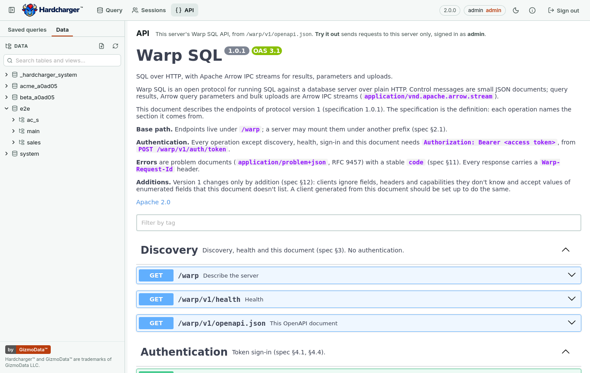
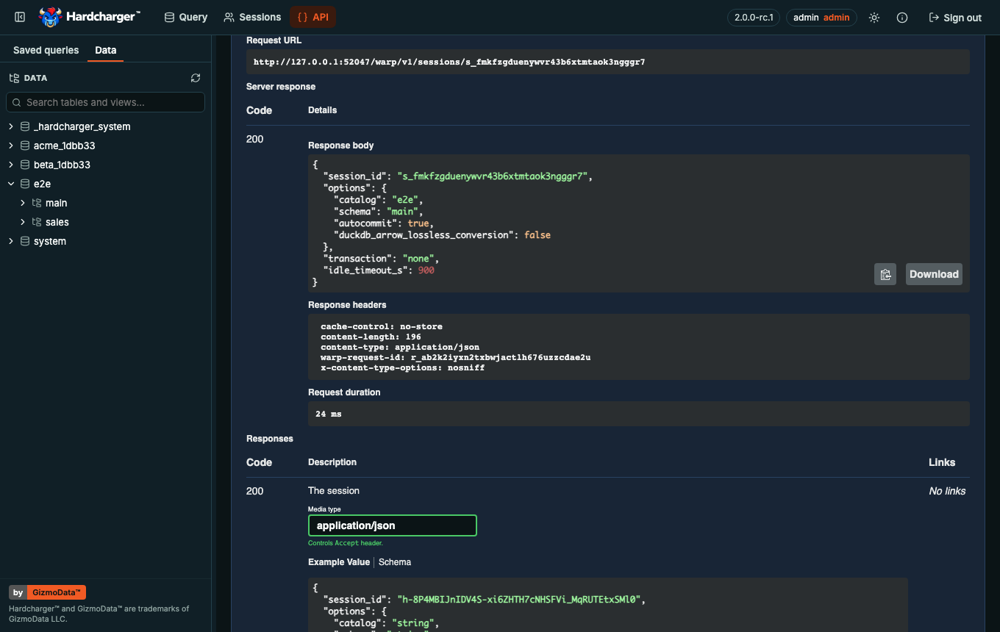
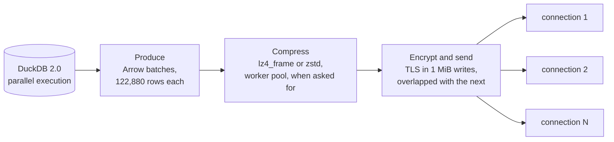
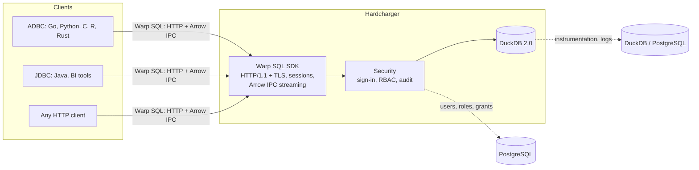

<p align="center">
  <a href="https://gizmodata.com">
    <picture>
      <source media="(prefers-color-scheme: dark)" srcset="docs/assets/hardcharger-banner-dark.png">
      
    </picture>
  </a>
</p>

<p align="center">
  <a href="https://hub.docker.com/r/gizmodata/hardcharger"></a>
  <a href="https://github.com/gizmodata/hardcharger/pkgs/container/hardcharger"></a>
  <a href="https://github.com/gizmodata/hardcharger/releases/latest"></a>
  <a href="https://github.com/gizmodata/warp-sql"></a>
  <a href="https://duckdb.org"></a>
  <a href="https://arrow.apache.org"></a>
  <br>
  <a href="https://pypi.org/project/hardcharger/"></a>
  <a href="https://pypi.org/project/adbc-driver-hardcharger/"></a>
  <a href="https://github.com/gizmodata/hardcharger-adbc"></a>
  <a href="https://github.com/gizmodata/hardcharger-jdbc"></a>
  <a href="LICENSE"></a>
  <a href="https://join.slack.com/t/gizmodatacommunity/shared_invite/zt-42jk7kdti-SJp7qk7d6XYCIKfBG~4HrA"></a>
  <a href="https://gizmodata.com"></a>
</p>

<h3 align="center">Fast, secure, remote DuckDB. Every feature included.</h3>

---

## 🏎️ What is Hardcharger?

**Hardcharger™** puts [DuckDB 2.0](https://duckdb.org) on the network. Clients connect over
[**Warp SQL**](https://github.com/gizmodata/warp-sql), an open HTTP protocol that moves
[Apache Arrow](https://arrow.apache.org) record batches straight from DuckDB to your
application: no gRPC, no Flight, no sidecars.

It is the successor to [GizmoSQL](https://github.com/gizmodata/gizmosql), rebuilt from
scratch for DuckDB 2.0, and it is free: no editions, no license keys. Everything that was
Enterprise in GizmoSQL is in every Hardcharger build.

- 🦆 **DuckDB 2.0 inside.** A standalone server on DuckDB's v2 C API, not an extension.
- ⚡ **Warp SQL on the wire.** A query and its first rows come back in one HTTP round trip.
  Large results stream as Arrow IPC, compressed with LZ4 or zstd when asked, and can be resumed. Bulk ingest
  streams Arrow straight into a table.
- 🔐 **Security in the core, not bolted on.** Token sign-in, TLS and mTLS, and role-based
  access control checked inside DuckDB against each statement's own plan. Also row
  policies, column masking, tenants, SSO (OIDC/JWKS) and a tamper-evident audit log.
- 🔭 **Observable.** Instrumentation into a DuckDB file or PostgreSQL, catalog logging (also
  into DuckLake), a Prometheus `/metrics` endpoint, query profiles and `KILL SESSION`.
- 🧩 **Configured your way.** Flags, `HARDCHARGER_*` environment variables, or a YAML file.
- 🌐 **Ready to scale out.** Results are already described as partitions with locations,
  so distributed query execution can arrive without a protocol change.

## 🖥️ Built-in web UI

<p align="center">
  
  
</p>

Hardcharger has a web UI compiled into the server binary: nothing extra to install, and it is
served on the server's own port and TLS certificate. It is off by default; `--web-ui` turns it on
(or `HARDCHARGER_WEB_UI=true`, or `web_ui: true` in the YAML file).

```bash
openssl req -x509 -newkey ec -pkeyopt ec_paramgen_curve:prime256v1 -nodes -days 30 -subj /CN=localhost -addext subjectAltName=DNS:localhost -keyout server.key -out server.pem
HARDCHARGER_ADMIN_PASSWORD='change-me' hardcharger-server --web-ui --tls-cert server.pem --tls-key server.key --database demo.duckdb
# open https://localhost:31337/ui and sign in as hardcharger / change-me (the certificate is self-signed)
```

- ✍️ **SQL editor**: up to 20 tabs, each with its own session (its own transaction, temporary
  tables and settings). Ctrl/⌘+Enter runs the statement at the cursor (a bar in the margin
  marks it) or exactly the selection; ⇧ runs all, with a result tab per result set and
  Messages. Cancel stops the statement on the server and says how far a script got. An open
  or failed transaction shows as a badge, with Commit and Rollback, straight from the server.
- 📊 **Results grid** for up to a million rows, in DuckDB's own formatting: sort (NULLs last),
  filter, resize columns, and select cells, ranges or rows like a spreadsheet, with the full
  keyboard. Ctrl/⌘+C copies so a paste into Excel or Google Sheets lands as cells (in every
  browser, Safari included); double-click or Enter shows a value in full, JSON pretty-printed.
- 🗂️ **Schema browser and autocomplete** that follow access control: each user sees only the
  catalogs, schemas, tables and columns their roles allow. Tables and Views in their own
  groups, columns with their types; double-click or drag a name into the editor (fully
  qualified, quoted where needed); preview a table, show a view's definition, search every
  table and view by name. Autocomplete offers tables, schemas, columns (through aliases too),
  functions and keywords.
- 💾 **Downloads** of the rows as shown (CSV, TSV, JSON, Excel) or the whole typed result
  (Parquet, Arrow IPC), made in the browser.
- 📁 **Saved queries** in folders, kept in the browser, with export and import as a file;
  **Run as** one of your roles under access control.
- 📐 A resizable editor and side panel (drag, keyboard, double-click to reset; kept in the
  browser), a short **How the editor works** help with the server's session idle timeout, and
  a layout for phone-sized screens.
- 🧭 **API page**: the server's own Warp SQL API, from its OpenAPI description
  (`/warp/v1/openapi.json`), in Swagger UI. **Try it out** sends requests to this server only,
  signed in as you: the page adds your sign-in to each request as it leaves, so there is no
  token to paste, and it never goes to another origin or into storage. Arrow results come back
  as a file to download.
- 🔏 **Certificate sign-in** under mutual TLS: the browser presents its client certificate to
  load `/ui` at all, and with `--mtls-certificate-sign-in` the page offers **Sign in with my
  certificate**, no password needed.
- 🌐 **Sign in with your identity provider**: with browser sign-in on (below), the page offers
  **Sign in with <provider>** beside the user name and password, and comes back signed in.
- 🛡️ The server's own sign-in, a short-lived token kept only in the tab, and a strict
  Content-Security-Policy: nothing loads from another origin.

<p align="center">
  
  
</p>

The UI's source is in [`ui/`](ui/README.md), built and tested with the server in the same CI run.

## 🚀 Performance

Measured on one machine (Apple M5 Max) against GizmoSQL 1.41 with the same data
([details and method](docs/benchmarks.md)):

| Workload | Hardcharger | GizmoSQL 1.41 | |
|---|---:|---:|---:|
| TPC-H SF10, all 22 queries | **832 ms** | 1,201 ms | **1.44× faster** |
| Fetch 10M rows (1.73 GB of Arrow) | **0.83 s** | 1.32 s | **1.59× faster** |
| 10 concurrent clients | **39.0 queries/s** | 21.9 queries/s | **1.8× the throughput** |
| 10 concurrent clients, p95 latency | **471 ms** | 1,328 ms | **2.8× lower** |

Over a real network: two AWS c8gn.8xlarge machines, TLS on both servers, median of five runs
([details and method](docs/benchmarks.md#remote-throughput-after-the-transfer-work-2026-10-17-featurethroughput);
the loads: [partitioned uploads](docs/benchmarks.md#partitioned-uploads-and-split-results-by-default-2026-10-17-featureingest-partitions)):

| Workload | Hardcharger | GizmoSQL 1.42 | |
|---|---:|---:|---:|
| Fetch TPC-H SF10 lineitem (60M rows, 10.5 GB of Arrow) | **0.97 s** | 15.2 s | **15.7× faster** |
| Fetch TPC-H SF1 lineitem (6M rows) | **0.148 s** | 1.74 s | **11.7× faster** |
| Fetch 100M narrow rows | **0.45 s** | 5.43 s | **12.0× faster** |
| Fetch SF1 lineitem across regions (46 ms away) | **1.96 s** | 12.26 s | **6.3× faster** |
| Load SF10 lineitem (bulk ingest, 8 upload parts) | **3.00 s** | 9.44 s | **3.1× faster** |
| Load SF1 lineitem across regions (8 upload parts) | **2.91 s** | 13.94 s | **4.8× faster** |

## ⚙️ How it's fast

Every result travels through an **asynchronous pipeline**: no stage waits for another
unless a queue is full.



- 🔁 **Overlapped stages.** DuckDB keeps producing while earlier batches are being compressed
  and encrypted, and the socket never waits for the next batch to be built. With TLS on, one
  stream runs as fast as plain HTTP.
- 🧵 **Parallel, selective compression.** `lz4_frame` (for fast links) or `zstd` (for slow
  ones) runs on a pool of threads, several batches at once, and the batches still leave in
  order. A buffer that a sample shows won't shrink enough is sent as it is, by reference,
  so compression costs only what it saves. The Go/Python driver picks the codec from the
  link's round trip by default.
- 🔀 **Partitioned results.** A client can ask for a large result as several partitions and
  read them over separate connections at once, past the limits of a single TCP stream and a
  single core. The order is kept when the query asks for one. The server sizes the split by
  the result: a few batches get a partition per two batches, a large result as many as the
  client reads (the Go/Python driver asks for up to 32, JDBC and the `hardcharger` CLI for
  8; `result_partitions`, `--result-partitions` change it). Small results still come as one
  stream.
- 📦 **Big batches.** Results go out in 122,880-row batches, so per-batch overhead is
  negligible; small queries still answer in one round trip.
- 📥 **Parallel ingest.** Uploads are read in 1 MiB pieces and inserted on all of DuckDB's
  threads, in one transaction: a failed load leaves nothing behind.
- 📤 **Partitioned uploads.** The Go/Python driver sends a load in 16,384-row slices as up to
  16 parts over separate connections at once (32 on a high-latency link; fewer for a small
  load; `adbc.warp.ingest.parts`), inserted from all of them in parallel and committed as
  one: all or nothing.

Correctness is never traded for speed: a result is complete only when every partition has
arrived with its end-of-stream marker, so a query that fails mid-stream can never look like
a short, successful one.

## ⚡ Quick start

### Docker

```bash
docker run --rm -p 31337:31337 -p 31338:31338 \
  -e HARDCHARGER_ADMIN_PASSWORD='change-me' \
  ghcr.io/gizmodata/hardcharger:latest
```

Images are multi-architecture (`linux/amd64`, `linux/arm64`) and published to both
`ghcr.io/gizmodata/hardcharger` and `docker.io/gizmodata/hardcharger`. Port 31337 speaks
Warp SQL; 31338 answers `/health`.

Installed extensions (`INSTALL`) and persistent secrets live under the home directory
(`~/.duckdb/`), as DuckDB keeps them. Without a usable one (no `HOME`, or a container run
as a user the image has no account for, which gets `HOME=/`), the server uses the
account's home from the password database, else `.duckdb/` in the database file's
directory, and says so at startup; mount a writable volume for the database (`--database
/data/my.duckdb`) and they go there. Init SQL can set `extension_directory` and
`secret_directory` to anywhere else.

`ghcr.io/gizmodata/hardcharger:main` (and `:sha-<commit>`) is the development build: the
newest commit on `main` that passed every CI gate, built exactly as a release. Use
`:latest` or a version tag for anything else.

### Python

```bash
pip install hardcharger
```

```python
import hardcharger

with hardcharger.Server(password="change-me") as server:
    print(server.uri)  # hardcharger://127.0.0.1:<port>?tls=false
```

The `hardcharger` package is the **server**: it downloads `hardcharger-server` for your
platform on first use and runs it. The **client** is `adbc-driver-hardcharger` (below);
`pip install "hardcharger[adbc]"` installs both, and `server.connect()` then returns a
connection. See [python/README.md](python/README.md).

### Binaries

Linux (x86-64 and arm64), macOS (Apple silicon) and Windows (x64 and arm64) builds are
attached to every [release](https://github.com/gizmodata/hardcharger/releases/latest):

```bash
tar -xzf hardcharger-macos-arm64.tar.gz
HARDCHARGER_ADMIN_PASSWORD='change-me' ./hardcharger-macos-arm64/bin/hardcharger-server --database my.duckdb
```

On Windows (PowerShell), unzip `hardcharger-windows-amd64.zip` or `-arm64.zip`, or run
`Hardcharger-windows-amd64.msi` / `-arm64.msi`, which installs under Program Files and
puts `hardcharger-server.exe` and the `hardcharger.exe` client on the PATH. Ctrl+C or
Ctrl+Break stops the server as SIGINT or SIGTERM does elsewhere.

```powershell
Expand-Archive hardcharger-windows-amd64.zip -DestinationPath .
$env:HARDCHARGER_ADMIN_PASSWORD = 'change-me'
.\hardcharger-windows-amd64\bin\hardcharger-server.exe --database my.duckdb
```

## 🔌 Connect

### Python (ADBC)

```bash
pip install adbc-driver-hardcharger
```

```python
from adbc_driver_hardcharger import dbapi as hardcharger

with hardcharger.connect(uri="hardcharger://localhost?tls=false", username="hardcharger", password="change-me") as conn:
    with conn.cursor() as cur:
        cur.execute(operation="SELECT 42 AS answer, ? AS greeting", parameters=["hello"])
        print(cur.fetch_arrow_table())
```

`hardcharger://host` is HTTPS on port 31337; `?tls=false` is plain HTTP for local
development. [hardcharger-adbc](https://github.com/gizmodata/hardcharger-adbc) is a native
Go driver, on the [Warp SQL ADBC driver](https://github.com/gizmodata/warp-sql-adbc), with
query and session tags, `hardcharger.*` settings and browser sign-in. Its library loads into
any ADBC driver manager (C/C++, R, Rust, ...) as `driver = "hardcharger"`, with the same
`hardcharger://` URIs, and Go programs import it directly.

### Java (JDBC)

```java
Properties properties = new Properties();
properties.setProperty("user", "hardcharger");
properties.setProperty("password", "change-me");
properties.setProperty("useEncryption", "false"); // plain HTTP on localhost
try (Connection connection = DriverManager.getConnection("jdbc:hardcharger://localhost", properties);
     ResultSet rows = connection.createStatement().executeQuery("SELECT 42 AS answer")) {
  rows.next();
  System.out.println(rows.getInt("answer"));
}
```

[hardcharger-jdbc](https://github.com/gizmodata/hardcharger-jdbc) is a single jar for Java 17+,
with no gRPC, Netty or protobuf: `jdbc:hardcharger://host[:port]` (port 31337 by default) on
the [Warp SQL JDBC driver](https://github.com/gizmodata/warp-sql-jdbc). Its README shows how
to add it to DBeaver and other BI tools.

### JavaScript

```js
import { connect } from "@gizmodata/hardcharger";

const conn = await connect({ url: "hardcharger://localhost?tls=false", username: "hardcharger", password: "change-me" });
const table = await conn.query("SELECT 42 AS answer, ? AS greeting", ["hello"]);
console.log(table.toArray().map((row) => row.toJSON()));
await conn.close();
```

[`@gizmodata/hardcharger`](https://github.com/gizmodata/hardcharger-js), the Hardcharger™
JavaScript client, takes the same `hardcharger://` URLs (port 31337 by default) and returns Arrow JS Tables or streams of record
batches, in Node, browsers (allow the page's origin with `--cors-origins`), Deno, Bun and
Cloudflare Workers. No native code, no gRPC. It is a thin layer on
[`@gizmodata/warp-sql`](https://github.com/gizmodata/warp-sql-js), the generic JavaScript client
for any Warp SQL server, which it re-exports.

### Plain HTTP

Warp SQL is plain HTTP, so `curl` works:

```bash
TOKEN=$(curl -s localhost:31337/warp/v1/auth/token -H 'Content-Type: application/json' \
  -d '{"grant_type": "password", "username": "hardcharger", "password": "change-me"}' | jq -r .access_token)
SESSION=$(curl -s localhost:31337/warp/v1/sessions -H "Authorization: Bearer $TOKEN" \
  -H 'Content-Type: application/json' -d '{}' | jq -r .session_id)
curl -s localhost:31337/warp/v1/sessions/$SESSION/statements -H "Authorization: Bearer $TOKEN" \
  -H 'Content-Type: application/json' -d '{"sql": "SELECT 42 AS answer"}' | jq .result
```

Ask for `Accept: application/vnd.apache.arrow.stream` and the rows arrive as an Arrow IPC
stream in that same response.

The server describes its API in OpenAPI 3.1 at `GET /warp/v1/openapi.json` (no sign-in
needed; discovery, `GET /warp`, lists it as capability `openapi`), for API tools and client
generators; the web UI's API page shows it:

```bash
curl -s localhost:31337/warp/v1/openapi.json | jq '{openapi, title: .info.title, paths: (.paths | length)}'
```

## 💻 Command-line client

`hardcharger`, the command-line client, ships beside `hardcharger-server` in every tarball
and in the image. It uses TLS by default. **Connect to a server without TLS:
`hardcharger --no-tls`** (the same as `--tls=false` or `--tls false`). Run it with no
statement for an interactive shell (it asks for the password, or reads
`HARDCHARGER_PASSWORD`):

```console
$ hardcharger --host localhost --no-tls --username hardcharger
Password:
Hardcharger Client 0.3.0
Connected to localhost:31337
Type '.help' for help, '.quit' to exit.

my.main> CREATE OR REPLACE TABLE trips AS SELECT * FROM (VALUES (1, 'Boston', 12.5), (2, 'Denver', 30.0)) t(id, city, miles);
OK, 2 rows affected
my.main> SELECT city, miles FROM trips ORDER BY miles DESC;
┌─────────┬──────────────┐
│  city   │    miles     │
│ varchar │ decimal(3,1) │
├─────────┼──────────────┤
│ Denver  │         30.0 │
│ Boston  │         12.5 │
├─────────┴──────────────┤
│ 2 rows  2 columns      │
└────────────────────────┘
my.main> .quit
```

History, tab completion, syntax highlighting, a pager for long results, dot commands
(`.help`, `.tables`, `.mode`, ...), and Ctrl-C cancels the running statement while the
shell goes on. A large result is read over up to 8 connections at once, in the same order;
`--result-partitions N` (or `HARDCHARGER_RESULT_PARTITIONS`) changes that, and `1` reads every
result over one connection.

One statement with `--command` (`-c`), in any output mode (`--csv`, `--json`,
`--markdown`, `--table`, or `.mode` for the rest):

```console
$ HARDCHARGER_PASSWORD='change-me' hardcharger --host localhost --no-tls --username hardcharger --csv \
    --command "SELECT city, miles FROM trips ORDER BY id"
city,miles
Boston,12.5
Denver,30.0
```

A script from a heredoc, a pipe or `--file`; the exit status is 1 when a statement fails:

```console
$ export HARDCHARGER_PASSWORD='change-me'
$ hardcharger --host localhost --no-tls --username hardcharger --quiet <<'SQL'
INSERT INTO trips VALUES (3, 'Austin', 8.5);
SELECT count(*) AS trips, sum(miles) AS miles FROM trips;
SQL
OK, 1 row affected
┌────────┬───────────────┐
│ trips  │     miles     │
│ bigint │ decimal(38,1) │
├────────┼───────────────┤
│      3 │          51.0 │
├────────┴───────────────┤
│ 1 row  2 columns       │
└────────────────────────┘
```

The client uses TLS unless told otherwise, as the drivers do: `--no-tls` (or `--tls=false`,
`--tls false`, `--tls off`, or `HARDCHARGER_TLS=false`) is plain HTTP, for a local server like
this one started without `--tls-cert`; in the shell, `.connect HOST PORT USERNAME --no-tls`.
Against such a server without it, the client says so and connects nothing in plaintext. When
nothing answers, the error says why (`Could not connect to http://localhost:9: connection
refused. Is the server running on that port?`), and a script run without any connection
options connects to the default (`https://localhost:31337`) at its first statement, so its
error is the connection's too. `--tls-roots` names a private CA, `--mtls-cert` and `--mtls-key` a client
certificate, and `--auth-type external` signs in through the server's browser sign-in. A URI
takes the place of `--host`, `--port` and `--tls`, with the Python driver's rules:
`hardcharger://db.example.com` is HTTPS to port 31337, and
`hardcharger 'hardcharger://localhost?tls=false' --username hardcharger` is plain HTTP. It is GizmoSQL's
`gizmosql_client`, on Warp SQL:
[docs/migrating-from-gizmosql.md](docs/migrating-from-gizmosql.md#the-command-line-client)
maps its options and lists what changed.

## 📦 Everything included

| | |
|---|---|
| 🦆 DuckDB 2.0, DuckLake and DuckDB's extensions | ✅ |
| 🖥️ Built-in web UI: SQL editor, results grid, schema browser, exports (`--web-ui`) | ✅ |
| ⚡ Warp SQL: streamed and resumable results, bind parameters, prepared statements, bulk ingest, lz4_frame and zstd | ✅ |
| 🔐 TLS and mTLS, password and token sign-in, SSO via OIDC/JWKS, browser sign-in, authorized e-mail filters | ✅ |
| 👥 Role-based access control: users, roles, grants, ownership, system privileges | ✅ |
| 🛡️ Row policies, column masking, tenants, per-catalog access rules, Open Policy Agent | ✅ |
| 🧾 Tamper-evident audit log | ✅ |
| 🔭 Session and statement instrumentation, catalog logging, query profiles | ✅ |
| 📈 Prometheus `/metrics` and SQL metrics | ✅ |
| 🚦 Statement queue, timeouts, `KILL SESSION`, `hardcharger_cancel()`, graceful shutdown | ✅ |
| 🔍 `hardcharger_active_connections()`, `hardcharger_server_info()` (no instrumentation needed) | ✅ |
| 💳 License key | Not needed |

## 🆚 Why Hardcharger instead of Quack?

[Quack](https://duckdb.org/docs/current/quack/overview) is DuckDB Labs' own remote protocol: a
DuckDB extension that lets one DuckDB serve its databases (`CALL quack_serve(...)`) and another
`ATTACH` them over HTTP. It comes from DuckDB's extension repository and loads on first use,
works on every platform DuckDB ships extensions for (Windows included) and in the browser through
DuckDB-Wasm, lets one query join remote tables with local ones, and it is fast. If every client
is a DuckDB you trust, Quack is the easy choice.

Hardcharger™ is built for the other case: one server that many people and applications share,
reached through drivers, with each user's access governed by the server. Both are young (Quack
is an experimental extension, Hardcharger is 0.x); this is what each offers today:

| | Hardcharger | Quack |
|---|:---:|:---:|
| `ATTACH` from DuckDB, joining remote tables with local ones | ✅ ¹ | ✅ |
| Drivers that don't embed DuckDB: ADBC, JDBC, JavaScript, `curl` | ✅ | ❌ ² |
| Browsers | ✅ | ✅ ³ |
| Bind parameters sent to the server | ✅ | ❌ ⁴ |
| Bulk ingest, cancellation | ✅ | ✅ |
| TLS | ✅ | ✅ ⁵ |
| Users with passwords, tokens, SSO (OIDC/JWKS) | ✅ | partial ⁶ |
| Client certificates (mTLS), as identity too | ✅ | ❌ ⁷ |
| Roles and grants, checked against each statement's plan | ✅ | partial ⁸ |
| Row policies, column masking, tenants, Open Policy Agent | ✅ | ❌ |
| Tamper-evident audit log | ✅ | ❌ |
| Instrumentation tables, Prometheus `/metrics` | ✅ | partial ⁹ |
| Statement queue, statement timeouts, `KILL SESSION` | ✅ | partial ¹⁰ |
| Standalone server: binaries, Docker image, Windows MSI, YAML config | ✅ | ❌ ¹¹ |
| Built-in web UI | ✅ | ❌ |
| Written, versioned protocol spec with a conformance suite | ✅ | partial ¹² |
| License | Apache 2.0 | MIT |

1. Through an ADBC extension for DuckDB and
   [hardcharger-adbc](https://github.com/gizmodata/hardcharger-adbc)'s driver library: Columnar's
   `adbc` or Query.Farm's `adbc_scanner`. Each attaches Hardcharger's tables, joins them with local
   ones and writes to them (`CREATE TABLE … AS` through `adbc`, `INSERT` through `adbc_scanner`).
   `adbc_scanner` sends filters to the server with bind parameters; `adbc` sends only the
   columns, and DuckDB filters the rows. Neither is published for DuckDB 2.0
   yet; both work on DuckDB 1.5.6, and `adbc` also on DuckDB 2.0 built from its source
   ([setup](docs/hardcharger-vs-quack.md#duckdb-to-hardcharger-through-adbc)).
2. Quack's clients are DuckDB itself (the CLI, or a DuckDB library such as Python's or
   DuckDB-Wasm) with the extension loaded. Results travel in DuckDB's own format, not Arrow.
3. Through DuckDB-Wasm. The Quack endpoint allows every origin (`Access-Control-Allow-Origin: *`).
4. Quack sends SQL text only. `SELECT … WHERE i = ?` on an attached table fails ("Values were not
   provided for the following parameters"), because the client sends `WHERE (i = $1)` to the
   server without the value. It runs with `SET disabled_optimizers = 'remote_pushdown'`, but then
   the client reads the whole table and filters it locally.
5. The server can use its own certificate or a self-signed one it generates; clients check it
   against a CA or pin its SHA-256 fingerprint.
6. One shared token by default. `quack_authentication_function` can point at your own SQL
   function (per-user tokens from a table, say), but the server keeps no user for the session;
   DuckDB's docs suggest writing an extension to record one.
7. The Quack server doesn't ask for a client certificate.
8. A hook, `quack_authorization_function`, gets each statement's text and can allow, refuse or
   rewrite it; by default it allows everything. DuckDB has no roles or grants.
9. Every Quack message can go to DuckDB's log (`CALL enable_logging('Quack')`), and
   `quack_active_connections()` lists connections and their current SQL. We found no metrics
   endpoint.
10. A connection limit (`quack_server_max_connections`) and `quack_cancel()`, which stops another
    connection's query. We found no statement queue and no server-side statement timeout.
11. Quack serves from inside any DuckDB process that runs `CALL quack_serve(...)`, and is set up
    with DuckDB settings in SQL.
12. Quack's protocol has a version that client and server agree on (version 3 in DuckDB 2.0),
    and its messages are defined in the extension's source. We found no separate specification or
    conformance suite, and DuckDB's docs say the protocol may still change.

Checked on running servers, with Quack `e7a9be3f8c` (the commit DuckDB 2.0 pins and its extension
repository serves) and Hardcharger; [docs/hardcharger-vs-quack.md](docs/hardcharger-vs-quack.md)
shows how.

### Where Hardcharger is faster

Measured on 2026-10-19 on AWS c8gn.8xlarge machines: server and client in one placement group
(LAN), or the client in another region, about 46 ms away (WAN). TLS on every server unless the
row says plaintext; median of five runs. Hardcharger at `2718a17e` with the Warp SQL ADBC
driver's default settings, Quack `e7a9be3f8c` attached from DuckDB 2.0, GizmoSQL 1.42 for
reference. These are the shapes where Hardcharger came out ahead;
[the full results](docs/benchmarks.md#lz4-selective-compression-and-result-sized-splits-2026-10-19-perfthroughput-2)
include the shapes where Quack is faster.

| Workload | Hardcharger | Quack | GizmoSQL 1.42 |
|---|---:|---:|---:|
| Fetch TPC-H SF1 lineitem (6M rows), WAN | **0.383 s** | 1.508 s | 12.972 s |
| Load SF1 lineitem, WAN | **1.107 s** | 1.801 s † | 13.802 s |
| Fetch SF1 lineitem, LAN | **0.126 s** | 0.164 s | 1.484 s |
| Load SF1 lineitem, LAN | **0.538 s** | 0.600 s † | 1.607 s |
| Fetch SF10 lineitem (60M rows), LAN, plaintext | **0.746 s** | 0.962 s | 13.216 s |

† Quack with `preserve_insertion_order = false`. Hardcharger's driver loads in parallel parts,
which keep no row order either. Quack keeping insertion order, its default, took 2.684 s (WAN)
and 1.016 s (LAN).

## ⚙️ Configuration

Every option is a flag (`--read-only`), an environment variable (`HARDCHARGER_READ_ONLY`)
or a key in a YAML file passed with `--config` (`read_only: true`). Flags win over
environment variables, which win over the file. `hardcharger-server --help` lists them all.

```yaml
# hardcharger.yaml
database: /data/analytics.duckdb
port: 31337
health_port: 31338
log_level: info
print_queries: true
init_sql_commands_file: /etc/hardcharger/init.sql
```

In SQL, `SET SESSION name = value` changes a DuckDB setting for your session only. A plain
`SET name = value` takes the setting's own default scope, which for about half of DuckDB's
settings (`arrow_lossless_conversion` among them) is `GLOBAL`: then only an administrator
may run it, and it changes the default of every session that has no value of its own.

### Credential and system files

With `block_sensitive_paths` on (the default), no statement can open, list, write, move or
delete the credential and system files on the server host, whoever runs it, the
administrator included:

- the home directory's `.ssh`, `.aws`, `.azure`, `.config/gcloud`, `.kube`,
  `.docker/config.json`, `.netrc`, `.pgpass`, `.git-credentials` and `.gnupg`, and DuckDB's
  secret directory (`~/.duckdb/stored_secrets`, or wherever the init SQL moved it);
- the server's own TLS key and certificate, client CA, init SQL file and config file;
- `/etc/passwd`, `/etc/shadow`, `/etc/gshadow`, `/etc/master.passwd`, `/etc/sudoers` and
  `/etc/sudoers.d`, `/proc` and `/dev/fd` (except `/proc/self/cgroup`, which DuckDB reads to
  size its memory limit), and `/var/run/secrets` and `/run/secrets` (container and
  Kubernetes secrets);
- on Windows, the account database and registry hives, DPAPI keys, Credential Manager and
  the vaults, installer answer files, and the device namespace (`\\.\`, `\\?\`);
- and any path listed in `sensitive_paths` (comma-separated).

The check sits in DuckDB's file system, so it sees the path DuckDB is about to use, however
the statement arrived at it: a literal, a concatenation, a variable, a prepared statement's
parameter, `query('…')`, a macro or view, `file_search_path`, `~`, `..`, a symlink, a second
hard link, or a different letter case where the file system ignores case. A refusal reads
`Permission denied: Hardcharger blocked access to '<path>' (<what it is>)`. A glob that
reaches into a protected directory from above (`/home/*/.ssh/*`, `**/id_rsa`) lists its
other matches only; one whose fixed part is protected (`~/.ssh/*`) is refused. SQL text is
not inspected for paths, so string literals such as `'{"a": 1}'`, `'.*'` or
`'~/.ssh/id_rsa'` used as values work as anywhere else. `SET secret_directory` is refused
after startup, because DuckDB's secret manager reads that directory outside its file system.

Two limits:

- The server's startup is not checked: its own attaches and the operator's init SQL
  (`init_sql_commands`, `init_sql_commands_file`) run before the guard switches on, so init
  SQL may read a mounted credential, for example to create a secret from it. (GizmoSQL 1.x
  checks init SQL too.)
- Extensions that do their own file I/O don't go through DuckDB's file system.
  `sqlite_scanner` is closed separately, at plan time (see the access-control section).
  `postgres_scanner` is not: PostgreSQL's client library reads `~/.pgpass`, and files named by
  `passfile=`, `sslkey=` and similar connection options, itself. So a statement that may
  `ATTACH` a PostgreSQL database (the administrator, or a role granted `MANAGE CATALOGS`) can
  make the server connect with a password or client key it finds there. Keep PostgreSQL
  credentials off a server host whose users you wouldn't trust with them.

## 🔍 Introspection

Three SQL functions show what the server is doing, with no instrumentation or metrics
turned on. `hardcharger_active_connections()` has a row per open session: who (user, role,
tenant, how they signed in), from where (the latest request's address and User-Agent, TLS
version, client certificate), what it runs (`state`: idle, queued, running, streaming,
idle_in_transaction or idle_in_transaction_aborted; the statement, redacted as the log
redacts it; since when), and its open result streams, partitions, uploads and retained
results:

```console
$ hardcharger --command "SELECT session_id, username, client_info, state, statement FROM hardcharger_active_connections() WHERE NOT is_current"
┌────────────────────────────────────┬─────────────┬────────────────────┬─────────┬──────────────────────────────────────────────────────────┐
│             session_id             │  username   │    client_info     │  state  │                        statement                         │
│              varchar               │   varchar   │      varchar       │ varchar │                         varchar                          │
├────────────────────────────────────┼─────────────┼────────────────────┼─────────┼──────────────────────────────────────────────────────────┤
│ s_dx7wohhsyptjqkqgukmrlp3ow5t2gtsa │ hardcharger │ hardcharger-client │ running │ SELECT count(*) FROM range(10000000000) a, range(1000) b │
├────────────────────────────────────┴─────────────┴────────────────────┴─────────┴──────────────────────────────────────────────────────────┤
│ 1 row  5 columns                                                                                                                           │
└────────────────────────────────────────────────────────────────────────────────────────────────────────────────────────────────────────────┘
```

`hardcharger_cancel(session_id)` stops what a session runs and keeps the session: its
statement ends cancelled (`cancel_reason` `cancelled`), result streams are cut off, uploads
in flight are aborted, and its next statement runs as usual. It returns whether there was
anything to stop. `KILL SESSION` does the same, then ends the session (`killed`):

```console
$ hardcharger --command "SELECT hardcharger_cancel(session_id) AS cancelled FROM hardcharger_active_connections() WHERE state = 'running' AND NOT is_current"
┌───────────┐
│ cancelled │
│  boolean  │
├───────────┤
│ true      │
├───────────┤
│ 1 row     │
└───────────┘
```

A statement's `statement_id` is its Warp SQL id (`q_...`), the one its client got in
`Warp-Statement-Id` and error responses. With instrumentation on (`--enable-instrumentation`),
the same id finds it in the history once it is over: `sql_executions.execution_id`, and
`sql_statements.statement_id` for a submitted statement (a prepared statement's row is its
`p_...`, with an execution per request under each request's `q_...`; the statements of a
script sent in one request are `q_....1`, `q_....2`, ...). The query log's `statement_id`
and `prepared_id` fields carry the same ids. Here the statement above, cancelled:

```console
$ hardcharger --command "SELECT statement_id, state, statement FROM hardcharger_active_connections() WHERE NOT is_current"
┌────────────────────────────────────┬─────────┬──────────────────────────────────────────────────────────┐
│            statement_id            │  state  │                        statement                         │
│              varchar               │ varchar │                         varchar                          │
├────────────────────────────────────┼─────────┼──────────────────────────────────────────────────────────┤
│ q_n5zugypkhvoe7e6poydlvnsqaqnfzk6d │ running │ SELECT count(*) FROM range(10000000000) a, range(1000) b │
├────────────────────────────────────┴─────────┴──────────────────────────────────────────────────────────┤
│ 1 row  3 columns                                                                                        │
└─────────────────────────────────────────────────────────────────────────────────────────────────────────┘
$ hardcharger --command "SELECT execution_id, status, cancel_reason, sql_text FROM _hardcharger_instr.execution_details WHERE execution_id = 'q_n5zugypkhvoe7e6poydlvnsqaqnfzk6d'"
┌────────────────────────────────────┬───────────┬───────────────┬──────────────────────────────────────────────────────────┐
│            execution_id            │  status   │ cancel_reason │                         sql_text                         │
│              varchar               │  varchar  │    varchar    │                         varchar                          │
├────────────────────────────────────┼───────────┼───────────────┼──────────────────────────────────────────────────────────┤
│ q_n5zugypkhvoe7e6poydlvnsqaqnfzk6d │ cancelled │ cancelled     │ SELECT count(*) FROM range(10000000000) a, range(1000) b │
├────────────────────────────────────┴───────────┴───────────────┴──────────────────────────────────────────────────────────┤
│ 1 row  4 columns                                                                                                          │
└───────────────────────────────────────────────────────────────────────────────────────────────────────────────────────────┘
```

`hardcharger_server_info()` is one row: the versions, the instance and cluster ids, the
start time and the uptime for everyone; the host (hostname, OS, CPU model and count,
memory), the listen addresses and ports, TLS and mutual TLS, the server certificate's
SHA-256 fingerprint, the web UI, the access-control store and the session count for an
administrator without `catalog_access` rules (NULL for everyone else):

```console
$ hardcharger --command "SELECT hardcharger_version, CAST(uptime AS VARCHAR) AS uptime, cpu_model, cpu_count, memory_total_bytes, session_count FROM hardcharger_server_info()"
┌─────────────────────┬─────────────────┬──────────────┬───────────┬────────────────────┬───────────────┐
│ hardcharger_version │     uptime      │  cpu_model   │ cpu_count │ memory_total_bytes │ session_count │
│       varchar       │     varchar     │   varchar    │  integer  │       bigint       │    integer    │
├─────────────────────┼─────────────────┼──────────────┼───────────┼────────────────────┼───────────────┤
│ 0.3.0               │ 00:00:01.097479 │ Apple M5 Max │        18 │        68719476736 │             2 │
├─────────────────────┴─────────────────┴──────────────┴───────────┴────────────────────┴───────────────┤
│ 1 row  6 columns                                                                                      │
└───────────────────────────────────────────────────────────────────────────────────────────────────────┘
```

Who sees and cancels what: an administrator without `catalog_access` rules, every session;
anyone else, a restricted administrator included, the sessions of their own principal (the
same user and tenant), and `hardcharger_sessions()` follows the same rule. Retained
(resumable) results are kept for `result_retention_seconds` (default 3600) after their
statement ends; the statement document's `expires_at` says until when.

With instrumentation on (`--enable-instrumentation`), the server keeps its history in
tables: `instances`, `sessions`, `sql_statements` and `sql_executions`, and the views
`session_activity`, `active_sessions`, `session_stats` and `execution_details`, which only
an administrator can read. By default they live in a DuckDB file next to the database
(`instrumentation_db_path`), for development or a single server. Use PostgreSQL in
production, and for any cluster of more than one replica: attach it in the init SQL and
name it in `instrumentation_catalog` (`instrumentation_schema` picks its schema). Any other
catalog, DuckLake among them, is refused at startup.

```yaml
init_sql_commands: "INSTALL postgres; LOAD postgres; ATTACH 'host=pg.internal dbname=ops user=hardcharger' AS ops (TYPE postgres);"
enable_instrumentation: true
instrumentation_catalog: ops
instrumentation_schema: hardcharger
```

Recording never holds up a statement. Records are queued and written by one background
writer in batches, a transaction each, so the tables keep up with tens of thousands of
statements a second however large they grow. A statement appears in `sql_executions` as
`queued` or `executing` from the writer's next batch, usually within milliseconds, and one
that starts and ends within a batch appears once, finished; `hardcharger_active_connections()`
always shows what runs now. If the catalog falls behind, the queue holds up to 128 MiB of
records and then drops new ones: `hardcharger_server_info()` counts them
(`instrumentation_queued`, `instrumentation_dropped`, `instrumentation_failed`), as does
`/metrics` (`hardcharger_instrumentation_*`), and the log says so at most once a minute. At
shutdown the server writes the backlog for up to 30 seconds, then closes its sessions and
executions in the tables.

## 👥 Access control

Point `rbac_store_uri` at a PostgreSQL database, the one every replica of a cluster
shares, and manage access in SQL:

```sql
CREATE ROLE analyst;
GRANT SELECT ON SCHEMA analytics TO analyst;              -- every table, now and later
GRANT SELECT (email, signup_ts) ON crm.users TO analyst;  -- two columns only
CREATE USER joe WITH PASSWORD '…';                        -- signs in with it
GRANT analyst TO joe;
CREATE VIEW published.daily AS SELECT … FROM raw.events;  -- read with its owner's rights
GRANT SELECT ON published.daily TO analyst;
REVOKE analyst FROM joe;                                  -- reaches joe's open sessions too
```

Each statement is checked inside DuckDB against its own plan, after binding and again
before optimizing, so nested SQL, views and macros can't route around a grant. Anything the
check can't classify is refused. Changes reach every replica within about a second.

Use PostgreSQL in production, and for any cluster of more than one replica. For
development, or a server that will only ever run one replica, the store can be a DuckDB
file instead:

```yaml
rbac_store_uri: duckdb:/var/lib/hardcharger/rbac.duckdb   # or any path ending in .duckdb
```

The file is created `0600` (one that other users can read or write is refused), only one
server may open it (a second one on the same file stops at startup), and no SQL statement
reaches it, the administrator's included. Each change is checkpointed into the file at
once, so nothing depends on its write-ahead log. There is no migration between the two
stores: moving to PostgreSQL later means creating the users, roles and grants there again.

The guard above sits in DuckDB's file system, and an extension with file I/O of its own
(`sqlite_scanner`) does not go through it: `ATTACH '<path>' (TYPE sqlite)`, the `sqlite:`
path prefix, and the `sqlite_scan` / `sqlite_query` / `sqlite_attach` table functions open
the file with SQLite's own library. So those are refused separately, when the resolved path
names one of the server's files or a sibling (the store, the database, the instrumentation
and log files, and their WAL and temporary siblings): at plan time, after the path has been
worked out, by every spelling — a computed path, `..`, a relative path, a symlink, a hard
link, a differing case, a Windows 8.3 name. Attaching an unrelated SQLite file still works.
A DuckDB-storage `ATTACH` of one of these files is left to the file-system guard, which
already covers it (and is how the server attaches its own). This closes the one way SQL
could reach the server's files outside DuckDB's file system; the `sqlite_scanner` load still
takes the administrator or a role granted `MANAGE EXTENSIONS`, which belong only to roles you
would trust with the server's files.

## 🌐 Browser sign-in (SSO)

People can sign in with your OpenID Connect identity provider in a browser: Warp SQL's
`oauth_browser` flow, on the server's own port and TLS. The `hardcharger` client
(`--auth-type external`), the drivers and the web UI all use it. Hardcharger is the
provider's confidential client: the client id and secret stay on the server, and clients get
Hardcharger's own access token, never the provider's tokens.

```yaml
token_allowed_issuer: https://login.example.com/oauth2/default   # found through its OpenID configuration
token_allowed_audience: hardcharger                               # the ID tokens' audience (the client id)
token_authorized_emails: ["*@example.com"]
token_default_role: user
oauth_client_id: hardcharger
# oauth_client_secret: from HARDCHARGER_OAUTH_CLIENT_SECRET, not the file
oauth_base_url: https://db.example.com                           # this server's public URL
oauth_provider_name: Okta                                         # "Sign in with Okta"
```

Register **`<oauth_base_url>/warp/v1/auth/oauth/callback`** with the identity provider as the
client's redirect URI (here `https://db.example.com/warp/v1/auth/oauth/callback`; the server logs
the one it uses at startup). `oauth_redirect_uri` overrides it. Earlier builds had a separate
sign-in port (31339, `/oauth/callback`): that port and its options are gone, so a redirect URI
registered for it must be replaced.

| Option | Default | Meaning |
|---|---|---|
| `oauth_client_id` | none | Set: browser sign-in is offered (needs `token_allowed_issuer` and `token_allowed_audience`) |
| `oauth_client_secret` | none | The client secret (prefer `HARDCHARGER_OAUTH_CLIENT_SECRET`) |
| `oauth_scopes` | `openid profile email` | |
| `oauth_base_url` | `http(s)://localhost:PORT` | The server's public URL, for the redirect URI; set, the web UI's return after sign-in is an absolute URL on it |
| `oauth_redirect_uri` | `<oauth_base_url>/warp/v1/auth/oauth/callback` | The redirect URI, given whole |
| `oauth_provider_name` | none | The provider's name for people; without it the UI says "single sign-on" |
| `oauth_instance_id` | none | Starts every `state` with `<id>.`, for a proxy on another origin that receives the provider's redirects for several servers and forwards each to its server's callback (set `oauth_redirect_uri` to the proxy and `oauth_base_url` to the server) |
| `oauth_max_flows` | `10000` | Sign-ins in progress at once (also at most 100 per client address); beyond, `429` |

The server sends the provider a code request with `state`, PKCE (S256) and a `nonce`, exchanges
the code itself, and signs the user in with the ID token exactly as `token_exchange` would:
the provider's JWKS, issuer, audience, `token_authorized_emails`, roles and, under access
control, the store's users. A sign-in is collected once by the client that started it, with a
secret that is never in a URL; sign-ins expire after 10 minutes. `hardcharger_server_info()`
has `oauth_enabled`.

### Who can do what

`SHOW GRANTS` answers for one user or role. To query, join and filter grants, use the
table functions below. They read the copy of the store the server already holds, and each
one returns only the rows the caller may see:

| Function | Rows |
|---|---|
| `hardcharger_grants()` | Object, column and system privileges, plus ownerships: grantee, privilege, object, grantor, grant option, tenant |
| `hardcharger_role_members()` | Who holds each role: users, roles, and identity-provider groups (`CREATE GROUP MAPPING`) |
| `hardcharger_roles()`, `hardcharger_users()` | Names and attributes that aren't secret (never a password hash or a token) |
| `hardcharger_policies()` | Row policies and column masks, with their expressions and whether they apply to you |
| `hardcharger_effective_privileges([user_name])` | What you hold after role inheritance, ownership, `SET ROLE` and a scoped token's limits, and the role each privilege comes from |

```sql
-- joe: what can I do, and which role gives it to me?
SELECT privilege, object_type, schema_name, object_name, column_name, via
FROM hardcharger_effective_privileges();
```
```text
privilege | object_type | schema_name | object_name | column_name | via
SELECT    | TABLE       | crm         | users       | email       | analyst
SELECT    | TABLE       | crm         | users       | signup_ts   | analyst
SELECT    | VIEW        | published   | daily       | NULL        | analyst
SELECT    | SCHEMA      | analytics   | NULL        | NULL        | analyst
```
With a second role as well (`CREATE ROLE finance; GRANT SELECT ON crm.users TO finance;
GRANT finance TO ann;`):

```sql
-- The administrator: who may read crm.users?
SELECT grantee, privilege, column_name FROM hardcharger_grants()
WHERE schema_name = 'crm' AND object_name = 'users';
```
```text
grantee | privilege | column_name
finance | SELECT    | NULL
analyst | SELECT    | email
analyst | SELECT    | signup_ts
```

The same query as joe returns only the two `analyst` rows. The administrator sees
everything, and `hardcharger_effective_privileges('ann')` answers for any user. A user sees
grants to the roles it holds (directly, inherited, or through its sign-in token's groups),
the memberships that give it those roles, those roles, its own user row, and policies on
tables it can see. It never sees another user's grants, whatever it filters or counts. A
tenant admin (holding its tenant's `tenant_admin` role) also sees everything of its own tenant:
its users, roles, memberships, grants and policies, and its users' effective privileges, and
nothing of another tenant's. An
administrator token with `catalog_access` rules sees grants, ownerships and policies only
on objects in the catalogs its rules reach, and no users or memberships. On a server without
an access-control store, every function returns no rows.

DuckDB's `information_schema` can't be extended, so the SQL standard's privilege views live
in the server's read-only system catalog, under `_hardcharger_system.hardcharger_information_schema`:
`table_privileges`, `column_privileges`, `role_table_grants`, `applicable_roles` and
`enabled_roles`. They keep the standard's column names (`grantor`, `grantee`,
`table_catalog`, `table_schema`, `table_name`, `privilege_type`, `is_grantable`, …), and a
schema or catalog grant appears once for each table and view in it. A tool that reads
`information_schema.table_privileges` reads the same columns under this qualified name.
They follow the same visibility rules:

```sql
SELECT grantee, table_schema, table_name, privilege_type
FROM _hardcharger_system.hardcharger_information_schema.table_privileges ORDER BY ALL;
```
```text
grantee | table_schema | table_name | privilege_type
analyst | analytics    | orders     | SELECT
analyst | published    | daily      | SELECT
```

## 🔏 Client certificates as identity

With mutual TLS (`mtls_ca_cert`), a client can sign in with its certificate and no
password: Warp SQL's `client_certificate` grant, `--auth-type mtls` in the `hardcharger`
client. The certificate proves who the user is; grants decide what they may do.

```yaml
tls_cert: /etc/hardcharger/server.pem
tls_key: /etc/hardcharger/server.key
mtls_ca_cert: /etc/hardcharger/client-ca.pem      # client certificates are verified against it
mtls_certificate_sign_in: true                    # off by default: certificates only admit connections
mtls_identity_source: san_email                   # or san_uri (SPIFFE IDs), subject_cn
mtls_admin_identities: [ops@example.com]          # sign in as the administrator
mtls_crl_file: /etc/hardcharger/client-ca.crl     # revocation, reloaded when it changes
```

| Option | Default | Meaning |
|---|---|---|
| `mtls_certificate_sign_in` | `false` | Offer certificate sign-in at all. Off, `mtls_ca_cert` only admits connections, and the grant is answered `unsupported_grant_type` |
| `mtls_require_client_cert` | `true` | Refuse connections without a certificate at the handshake; `false` lets them connect and sign in another way |
| `mtls_identity_source` | `san_email` | Which part of the certificate is the identity. A certificate with none, or several, values of that kind is refused |
| `mtls_admin_identities` | none | Identities that sign in as the administrator. Under access control, any other identity must be a user of the store (`CREATE USER "joe@example.com"`, a password optional); without it, no other identity signs in |
| `mtls_crl_file` | none | PEM CRLs, one for every CA of a client's chain (the root's too): every certificate of the chain is checked, so a revoked intermediate revokes what it issued, and a CA without a CRL is refused. A revoked certificate is refused at the handshake. The file is looked at every 5 seconds and reloaded when it changes, and open connections are checked again then and when a CRL passes its nextUpdate (an expired CRL refuses everything) |
| `mtls_crl_allow_missing_ca_crls` | `false` | Accept a CA above the leaf that has no CRL in the file |
| `mtls_require_identity_match` | `false` | A password or token sign-in over a client certificate must be for the certificate's identity |

A browser page on another origin (one of `cors_origins`) can sign in with the user's
certificate too: allowed origins get `Access-Control-Allow-Credentials: true`, and the page
calls with `credentials: "include"` (`@gizmodata/warp-sql` does with `authType:
"client_certificate"`). The browser's CORS preflight carries no credentials and may come
without a certificate, so for such pages set `mtls_require_client_cert: false`: the
handshake then admits the preflight, and the sign-in still needs the certificate. Pages on
the server's own origin (the embedded UI) send no preflight and need neither.

Tokens from a certificate sign-in are bound to it (RFC 8705's `cnf` claim): they work only on
connections presenting the same certificate, so a copied token is no use without the private
key. A session opened with such a token, and any scoped token minted from it, stay bound to the
same certificate (a session takes only tokens bound as its opener's was, and a bound session
can't mint scoped tokens `FOR USER` someone else). Identities are printable ASCII. Every refusal
(a bound token on the wrong connection, another identity's sign-in, a revoked certificate, an
unknown identity) is a security warning in the log and an audit record, with the user, the
token's id, the certificate presented and the client's address. They are rate-limited per source (ten a minute
in full, then one summary that counts the rest), a connection is closed after five failed
sign-ins, and certificates the TLS handshake refuses (revoked, expired, untrusted) are
recorded too. Identities match user names as user names compare (ignoring ASCII case), except URI identities such as
SPIFFE IDs, whose paths are case-sensitive: they must match exactly, case included. Under access
control a SPIFFE ID is a user name like any other:
`CREATE USER "spiffe://example.org/ns/etl/sa/loader"` (always system scope, never a tenant's).
Of several CRLs from one CA the newest is used; delta CRLs are refused. TLS has to end at Hardcharger (a TCP or TLS-passthrough load balancer) for this; a
proxy that ends TLS takes the certificate with it. Sign-ins with a certificate are written to
the audit log (`kind: authentication`, `method: client_certificate`, the identity and the
certificate's thumbprint).

## 🏗️ Architecture



## 🛠️ Build from source

```bash
git clone --recurse-submodules https://github.com/gizmodata/hardcharger.git
cd hardcharger/server
./scripts/build-deps.sh                      # DuckDB 2.0, Arrow C++ and replxx, pinned
OPENSSL_ROOT_DIR=$(brew --prefix openssl@3) cmake -S . -B build -G Ninja
cmake --build build
```

To embed the web UI, build it first (Node 24 or later) and point the server's build at the
tarball it makes:

```bash
(cd ../ui && npm ci && npm run build && npm run package)   # ui/release/hardcharger-ui-<version>.tar.gz
cmake -S . -B build -G Ninja -DHARDCHARGER_WEB_UI="$(ls "$PWD"/../ui/release/hardcharger-ui-*.tar.gz)"
cmake --build build
```

CMake checks every file against the tarball's `MANIFEST`, gzips each one into the binary and
logs the build's content SHA-256. [ui/README.md](ui/README.md) covers the UI's own checks and
its browser tests.

## 🧪 Test

```bash
docker compose -f server/tests/docker-compose.yml up -d --wait   # PostgreSQL + S3 for the DuckLake suites
docker run -d --name hardcharger-test-pg -e POSTGRES_USER=hardcharger \
  -e POSTGRES_PASSWORD=hardcharger -e POSTGRES_DB=hardcharger \
  -p 127.0.0.1:55433:5432 postgres:17-alpine                       # the access-control store
cd server/tests
uv venv .venv && uv pip install --python .venv/bin/python -r pyproject.toml
.venv/bin/python -m pytest -q                                    # -m "not services" without Docker
                                                                 # -m "not web_ui" on a build without the UI
```

The Warp SQL conformance suite runs against the same build:

```bash
cd third_party/warp-sql/conformance
uv venv .venv && uv pip install --python .venv/bin/python -e .
WARP_SQL_TEST_SERVER_BINARY=../../../server/build/hardcharger-server \
WARP_SQL_TEST_SERVER_PASSWORD_ENV=HARDCHARGER_ADMIN_PASSWORD \
WARP_SQL_TEST_SERVER_USERNAME=warp HARDCHARGER_ADMIN_USERNAME=warp \
WARP_SQL_TEST_SERVER_MTLS_FLAG=--mtls-ca-cert WARP_SQL_TEST_SERVER_CORS_FLAG=--cors-origins \
WARP_SQL_TEST_SERVER_IDLE_FLAG=--session-idle-timeout \
WARP_SQL_TEST_SERVER_DRAIN_FLAG=--shutdown-grace-period-seconds \
  .venv/bin/python -m pytest -q
```

Its access-control tests (`test_authorization.py`) need the `WARP_SQL_TEST_AUTHZ_*` variables
that `.github/workflows/server.yml` sets (a DuckDB access-control store, privileges granted to a
role); without them they skip, saying so.

The access-control suites run on PostgreSQL by default; `HARDCHARGER_TEST_RBAC_STORE=duckdb
.venv/bin/python -m pytest -q -m rbac_store` runs them again on the DuckDB file store, as CI does.

The web UI's lint, typecheck, unit and browser tests (Chromium and WebKit, against a server
build that embeds it) are in [ui/README.md](ui/README.md#end-to-end-tests).

The client's 1.x shell script runs on its own too (`bash server/tests/test_client_shell.sh`).
Suites that need PostgreSQL or the S3 gateway fail, never skip, when those aren't there.
[BATTERY.md](server/tests/BATTERY.md) tracks GizmoSQL's test battery as ported, file by file.

## 🔁 Coming from GizmoSQL

Hardcharger takes only its own names: `HARDCHARGER_*` variables, `hardcharger_*` SQL
functions, `_hardcharger_*` catalogs. [docs/migrating-from-gizmosql.md](docs/migrating-from-gizmosql.md)
maps every GizmoSQL name to its Hardcharger name.

## 💬 Community and support

- Chat with us in the [GizmoData Community Slack](https://join.slack.com/t/gizmodatacommunity/shared_invite/zt-42jk7kdti-SJp7qk7d6XYCIKfBG~4HrA).
- Report bugs and ask for features in [GitHub issues](https://github.com/gizmodata/hardcharger/issues).
- For support plans, or to have GizmoData run it for you on [GizmoData Cloud](https://gizmodata.com),
  write to [sales@gizmodata.com](mailto:sales@gizmodata.com).

## 📄 License

Apache License 2.0; see [LICENSE](LICENSE).

The binaries contain third-party open-source software, each part under its own licence:
[THIRD_PARTY_NOTICES.md](THIRD_PARTY_NOTICES.md) lists every statically linked library (DuckDB
and what it vendors, its built-in extensions, Arrow, Boost, OpenSSL and the rest) with its version
and full licence text. The embedded web UI's JavaScript packages are listed in
`THIRD_PARTY_NOTICES-web-ui.txt`. Every release archive, the MSI and the container image
(`/usr/share/doc/hardcharger/`) carry both files, `hardcharger-server --licenses` and
`hardcharger --licenses` print them, and the web UI links its own from **About** (**Open-source
licences**). Note that the built-in `tpch` extension's data generator is under the TPC's End User
License Agreement, not an open-source licence.

---

<p align="center">
  <a href="https://gizmodata.com"></a><br>
  <sub>Built by <a href="https://gizmodata.com">GizmoData™</a></sub><br>
  <sub>Hardcharger™ and GizmoData™ are trademarks of GizmoData LLC.</sub>
</p>
