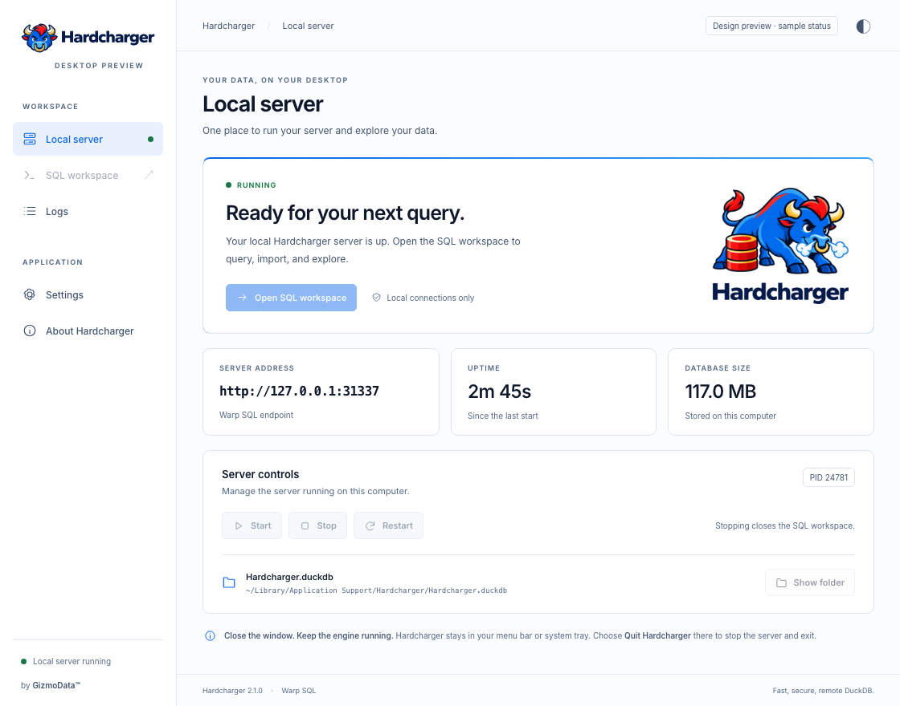

# Desktop app

**Available in v2.1.0+.** Hardcharger for macOS 15+ on Apple silicon and Windows combines a native server
dashboard with the server's SQL workspace. The desktop app supplements the existing
command-line packages. Linux desktop packaging is planned; Linux server and CLI builds
remain available.

## Runtime requirements

- **macOS:** version 15 or later on Apple silicon; WebKit and Keychain are supplied by the OS.
- **Windows:** x64 or Arm64 with Microsoft Edge WebView2. The MSI installs WebView2 if missing;
  that download needs an internet connection. Passwords use Windows Credential Manager.

The server, CLI, DuckDB and web UI are bundled. No separate Node.js, Python, Docker or
database installation is required. Optional DuckDB extensions download when first needed
and are cached for later use.

## Choose a download

Download the package for your computer from the matching [GitHub release](https://github.com/gizmodata/hardcharger/releases).

| Package | Use it for |
| --- | --- |
| `Hardcharger-desktop-macos-arm64.dmg` | macOS desktop app on Apple silicon; drag Hardcharger to Applications. Release builds are signed and notarized. |
| `Hardcharger-desktop-windows-amd64.msi` or `-arm64.msi` | Windows desktop app; choose x64 or Arm64. Release installers are signed. |
| `hardcharger-<platform>-<arch>.tar.gz` / `.zip` | Server and CLI for terminals, automation and service deployment. |
| `Hardcharger-windows-amd64.msi` or `-arm64.msi` | Windows installer for the command-line tools, added to PATH. |

Feature-branch preview packages can be unsigned or ad hoc signed. They are review builds;
release signing and notarization are checked by the release workflow. App stores are
follow-up work.

## Start and open the workspace

1. Open **Hardcharger**. By default it starts its own server on `127.0.0.1:31337`.
2. Choose **Open SQL workspace** to open the server's embedded web UI, signed in by the app.
3. Use **Start**, **Stop** and **Restart** on the dashboard or in the menu bar/system tray.
   Stop and Restart ask for confirmation before closing SQL windows, interrupting active
   work and disconnecting clients. Cancel or Escape leaves the server running.
4. Close the dashboard to keep the server running. Choose **Quit Hardcharger** to shut down
   the server and app. **Launch at login** is optional, under Settings.

The controller starts the same `hardcharger-server` executable as the command-line package,
as a child process. The SQL workspace connects to it over Warp SQL. The app bundles the
`hardcharger` command-line client too. It owns a separate database and preferences directory;
it does not automatically adopt an existing command-line database or server. A port conflict
is reported instead of attaching to another server.

The desktop app runs as the signed-in user. Menu-bar/tray residency does not keep a sleeping
computer awake or make the app a system service. Use the server packages with your service
manager when the server must operate independently of a desktop login.

Closing the **SQL workspace** ends that window's sessions before closing. An open
transaction requires confirmation; Cancel or Escape keeps the workspace and its sessions.
Reopening starts fresh sessions and restores saved editor text. Closing the workspace
also closes its query-detail windows and ends their observer sessions. Cancelling the
transaction-close prompt keeps those windows open too. Closing the desktop
dashboard still leaves the server running in the menu bar or system tray.
On macOS, the **Window** menu lists open workspaces and query inspectors, including
windows behind the dashboard.

## Settings and logs

**Settings** exposes options from the bundled server, grouped by category. Search setting
names, enable **Override** to change a default, and use dropdowns for booleans and fixed
choices. Save settings before starting; server options take effect at its next start.
Unsaved or invalid network settings block startup and show what needs attention.

**Import YAML** previews changes before applying them. **Export YAML** omits passwords
and other secrets. Desktop-managed networking and credentials are set through the app,
and desktop preferences such as launch at login are not server YAML options. Sensitive
values are stored in macOS Keychain or Windows Credential Manager. macOS may ask permission
to read the app's saved credential, especially after an ad hoc preview rebuild.

**Logs → Live tail** follows new output every two seconds. Turn it off to pause, or use
**Refresh** for a single update. Scrolling up keeps your place while you read earlier lines.

The SQL workspace's [Server Configuration tab](sql-monitor.md#server-configuration) edits
supported runtime settings. Those changes are separate from saved desktop settings and
do not survive a server restart.

## Allow connections from other computers

1. Stop the server and open **Settings → Network access**.
2. Choose **Allow network connections**. Select the listen IP and enter the server DNS
   name/IP clients will use. Detected local addresses and the computer's hostname help
   fill these fields; they do not create DNS records or change firewall rules.
3. Keep **TLS — encrypted** selected. Supply certificate-chain and private-key PEM paths,
   or choose **Generate certificate and key**. Set the administrator user name and password.
4. Choose **Save settings**, then start the server. The dashboard shows the SQL workspace
   and connection examples for other computers. Allow inbound TCP traffic on the selected port
   in your firewall if needed, and keep this computer awake.

**Connect from another computer** has tabs for **Web UI**, **Python / ADBC**, **JDBC**,
**CLI** and **JavaScript**. Each shows a text example with a clipboard button, populated
with the saved DNS name/IP and port. Client examples use `hardcharger://` (JDBC uses
`jdbc:hardcharger://`); the Web UI tab uses the matching HTTP(S) URL. TLS is detected from
the server endpoint, so an HTTP server's examples explicitly disable encryption.
Examples read the client's credentials from `HARDCHARGER_USER` and
`HARDCHARGER_PASSWORD`; saved server passwords are never copied. For a private CA,
set `HARDCHARGER_TLS_ROOTS` to its public PEM certificate on the client, or use the
CLI's `--tls-roots` option. Browser clients need their own CA trust setup.

A generated certificate covers the chosen name and current detected addresses and lasts
one year. The app shows the public CA certificate and its SHA-256 fingerprint. Share only
`Hardcharger-local-CA.crt`; keep `server.key` private. Clients can trust that CA or pass it
to the CLI with `--tls-roots /path/to/Hardcharger-local-CA.crt`.

**Open SQL workspace** asks for explicit approval if its generated CA is not trusted yet.
On macOS it requests trust for the current user and server address; Windows opens the
current-user certificate import wizard. Review the fingerprint before approving. Certificate
verification stays enabled. Other client computers need their own trust setup. A changed
address may require a new certificate and renewed trust.

**Only this computer** is the default. Invalid network settings never silently switch the
server back to local-only mode. HTTP is an explicit unencrypted alternative for a private
network; it sends credentials and SQL without encryption.

## Monitor and configure the server

The workspace includes the same administrator tabs as the server's browser-based `--web-ui`:

- **SQL Monitor** shows active work, recent outcomes, timeouts, queue status and captured
  profiles. Enable `enable_instrumentation` in desktop Server options, save, and restart.
- **Server Configuration** shows session and global values and allows supported runtime
  edits and resets, even without instrumentation.

Both require an unrestricted administrator. See the [SQL Monitor guide](sql-monitor.md)
for status meanings, profiles, session controls and runtime-setting scopes. For building
and signing the app, see [desktop/README.md](../desktop/README.md).

**About Hardcharger** links to the documentation, product website and GizmoData.
