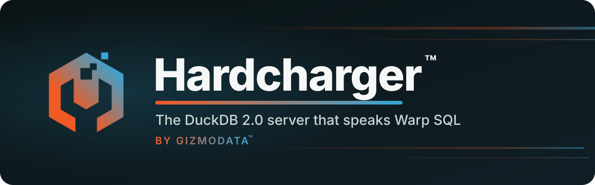
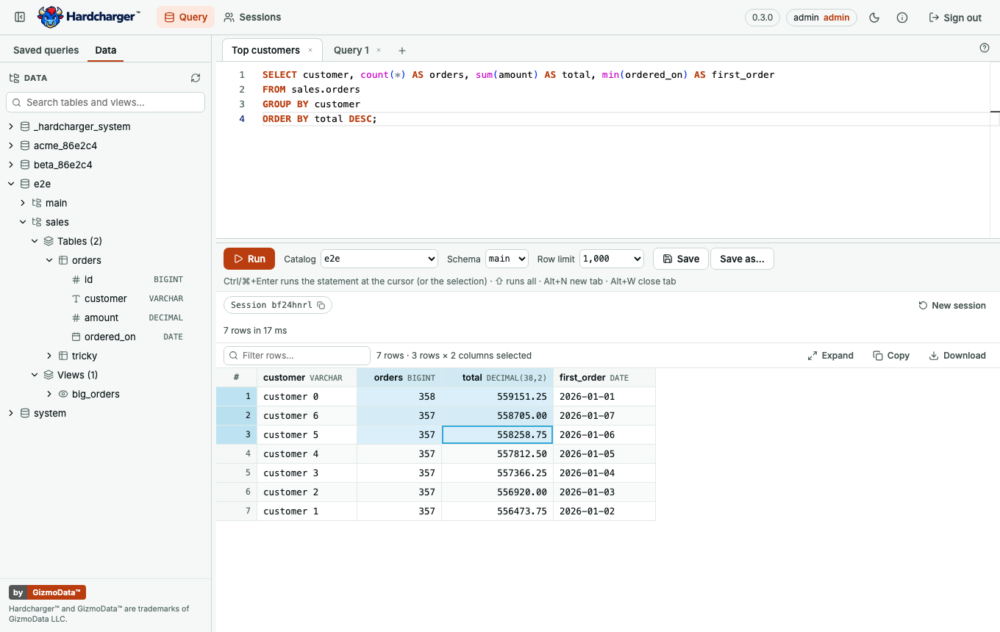

<p align="center">
  <a href="https://gizmodata.com">
    
  </a>
</p>

# Hardcharger's web UI

The browser UI that [Hardcharger](../README.md#️-built-in-web-ui) serves at `/ui` when started
with `--web-ui`: a static single-page app (React 19, Vite, TypeScript) compiled into
`hardcharger-server`, on the server's own port, origin and TLS certificate. There is no Node
backend and no cross-origin access: the browser speaks [Warp SQL](https://github.com/gizmodata/warp-sql)
(plain HTTP and Apache Arrow) to the server with [`@gizmodata/warp-sql`](https://github.com/gizmodata/warp-sql-js).

<p align="center">
  
</p>

- ✍️ **SQL editor** (Monaco), in tabs: up to 20, each with its own Warp SQL session, so one
  tab's long query or open transaction never touches another. New with **+** or Alt+N, close
  with **×** or Alt+W (asking first when a transaction is open or text is unsaved),
  double-click to rename, drag to reorder; a spinner, a red dot or an amber dot says a tab is
  running, failed, or in a transaction. Tabs, their text, catalog, schema and row limit come
  back after a reload (kept in this browser).
- ▶️ **Run** (Ctrl/⌘+Enter, Ctrl+Enter on a Mac too) runs the statement at the cursor, marked
  by a bar in the margin, or exactly the selected text. **Run all** (⇧+Ctrl/⌘+Enter) runs every
  statement in order, stopping at the first error, with a result tab for each result set and
  **Messages** listing each statement's rows and time; a script keeps at most 50 result sets
  and 64 MiB of results in the browser (the rest still run). The **Catalog** and **Schema**
  pickers set the session's (a `USE` moves them) and the **Row limit** is 100 to 1,000,000
  (1,000 by default), with "truncated at … rows" when a result is cut.
- 🔁 **Sessions and transactions**: `BEGIN` shows **In transaction** with Commit and
  Rollback, and a failed statement **Transaction failed — Rollback to continue**, as the server
  reports them (the session document's `transaction`, Warp SQL §5.2); the pickers lock while
  one is open. The session chip shows the server's id for the session (its logs and
  `KILL SESSION` use it) and copies it; **New session** starts afresh. When the server has lost
  a tab's session (idle timeout, restart), the next run starts a new one and says so, unless a
  transaction was open: then nothing runs, and the message says it was rolled back.
- 📊 **Results grid** for up to a million rows (only the rows in view are drawn), with DuckDB's
  own formatting of decimals, dates, timestamps, intervals, lists, structs, maps and blobs.
  - **Sort**: click a column header (again for descending, a third time to clear); NULLs sort
    last either way. **Filter rows…** keeps the rows where any column contains the text.
  - **Resize columns**: drag a header's right edge, double-click it to fit, or focus it and use
    the arrow keys.
  - **Select** like a spreadsheet: click a cell; arrows, Home/End, Page Up/Down and Ctrl/⌘ with
    them move it; Shift (keys or click) or a drag selects a range, scrolling past the edge; row
    numbers select rows (drag for several); Ctrl/⌘+A selects every row shown; Esc keeps only
    the active cell. The toolbar says how much is selected; a sort or filter starts over.
  - **Copy**: Ctrl/⌘+C copies the selection as text and as an HTML table, so Excel and Google
    Sheets paste it as cells, full values (not the grid's shortened text), NULL as an empty
    cell, a line break kept inside its cell, and text like `00123` kept as text; a single cell
    copies as its bare value. **Copy** in the toolbar copies the rows shown, with headers.
  - **Inspect**: double-click a cell, or press Enter, for the whole value; nested values and
    JSON text are pretty-printed (every digit of a big number kept). **Copy value** copies it;
    Esc closes, and the selection is still there.
  - **Expand** fills the tab with the results; **Restore** brings the editor back.
- 🛑 **Cancel** stops the statement on the server, not just the wait for it, and says how far
  a script got and whether the transaction now needs a rollback.
- 🗂️ **Schema browser** (the side panel; hide it with the panel button in the header, drag its
  edge to resize): the catalogs, their schemas, **Tables** and **Views** in separate groups,
  and columns with their types, each level listed when opened through the Warp SQL metadata
  calls, so it shows exactly what the server's access control lets the user see. The active
  tab's catalog starts open; `temp` (one session's own) is left out.
  - **Double-click** a name, or **drag** it into the editor: tables and views go in fully
    qualified (`lake.main.orders`), schemas as `catalog.schema`, columns as their name, quoted
    where needed (`lake.main."Order Lines"`).
  - The **…** button or a right-click: Insert name, Copy name, Preview data (a new tab with
    `SELECT * … LIMIT 100`, run at once, on that catalog and schema), Insert column names,
    Insert SELECT statement, Show definition (views; open it in a new tab to change it), Use
    this catalog / Use this catalog and schema (not while the active tab has a transaction).
  - **Search tables and views** (two or more characters) finds them by name in every catalog
    the user may see, up to 100; click one to show it in the tree. Esc clears.
  - A run that creates, drops, alters, attaches or detaches something lists what's open again;
    **Refresh** does it by hand. A listing that fails says why, with **Retry**.
- 💡 **Autocomplete** (as you type, or Ctrl+Space): after `FROM`, `JOIN`, `INTO`, `UPDATE`,
  `TABLE` or `DESCRIBE`, the current schema's tables, then the catalog's schemas and the
  catalogs; after a dot, a catalog's schemas, a schema's tables, or a table's columns with
  their types (also through an alias, `o.` for `FROM orders o`); elsewhere, the statement's
  columns, the server's functions (inserted with parentheses) and keywords. Names that need
  quotes are inserted quoted; nothing is offered inside a string or a comment. The lists come
  from the server, as the user may see them, kept a few minutes and refreshed after a run
  that changes the catalog.
- 💾 **Exports**: CSV, TSV, JSON (exact numbers) and Parquet (every Arrow type, written in the
  browser by parquet-wasm).
- 👥 **Sessions**: an administrator sees every session on the server and can end one
  (`KILL SESSION`); everyone else sees their own.
- 🔐 **Hardcharger's own sign-in and access control.** The password goes once to
  `POST /warp/v1/auth/token`; the browser keeps only the short-lived access token, in memory
  and this tab's `sessionStorage`, never in `localStorage` or a cookie. Under mutual TLS, the
  browser presents its client certificate to load `/ui` at all, and with
  `--mtls-certificate-sign-in` the page offers **Sign in with my certificate** (the UI uses
  fetch's default credentials mode, never `omit`, which would leave the certificate off).
- 🎨 GizmoData's look: the README banner's orange and Warp blue, light and dark themes (the
  system's choice until you pick one), Inter embedded in the build (SIL Open Font License 1.1,
  served as `/ui/fonts/Inter-LICENSE.txt`).

## 🛡️ Serving it

`npm run build` writes a self-contained directory, `dist/`: `index.html`, `favicon.png`,
`fonts/Inter-LICENSE.txt`, and `assets/` with content-hashed file names. The server embeds it and serves it with these rules
(written down once in [`scripts/ui-contract.mjs`](scripts/ui-contract.mjs), which
`scripts/serve.mjs` and the e2e tests use):

| Request                                                             | Answer                                                          |
| ------------------------------------------------------------------- | --------------------------------------------------------------- |
| `/ui`                                                               | `308` to `/ui/`                                                 |
| `/ui/` and any path under `/ui/` whose last segment has no dot      | `index.html` (the app's own routes, such as `/ui/sessions`)     |
| an existing file                                                    | the file, with its content type (`.wasm` is `application/wasm`) |
| a missing file (anything under `/ui/assets/`, or a name with a dot) | `404`, `Cache-Control: no-store`                                |
| anything else outside `/ui` and `/warp`                             | not the UI's: the server's own `404`                            |

`/ui/assets/*` is `Cache-Control: public, max-age=31536000, immutable`; everything else
(`index.html` above all) is `no-cache`, so a new build is picked up at once. The server sends
a file gzip makes smaller as `Content-Encoding: gzip` (with `Vary: Accept-Encoding`) to a client
that accepts it and plain otherwise, each with its own `ETag`, and answers `If-None-Match` with
`304`. Every `/ui`
response carries `X-Content-Type-Options: nosniff`, `Referrer-Policy: no-referrer`,
`X-Frame-Options: DENY`, `Cross-Origin-Opener-Policy: same-origin`,
`Cross-Origin-Resource-Policy: same-origin` and this Content-Security-Policy:

```text
default-src 'self'; script-src 'self' 'wasm-unsafe-eval'; worker-src 'self';
style-src 'self' 'unsafe-inline'; img-src 'self' data:; font-src 'self'; connect-src 'self';
object-src 'none'; base-uri 'none'; form-action 'self'; frame-ancestors 'none'
```

The e2e tests run under this policy and fail on any violation; taking `'wasm-unsafe-eval'` or
`'unsafe-inline'` out makes them fail. The exceptions:

- `'wasm-unsafe-eval'`: the Parquet export compiles WebAssembly. It allows WebAssembly only,
  not `eval` of JavaScript.
- `style-src 'unsafe-inline'`: the editor writes `<style>` elements and style attributes at run
  time.
- `img-src data:`: two small images in the editor's stylesheet (the color picker's
  background; no test reaches it, and it costs nothing to allow).

The editor's worker is a file of its own (`worker-src 'self'`, no `blob:`).

When an upgrade replaces the hashed files, a tab opened before it may ask for one that is gone.
The page then reloads after 0, 3 and 10 seconds (long enough for a rolling restart), and after
that says that a new version is available. The header and the schema browser stay usable
throughout: the pages sit inside an error boundary of their own, inside the layout.

## 📦 How the server embeds it

`npm run build` writes `dist/`; `npm run package` packs it as
`release/hardcharger-ui-<version>.tar.gz` (the version is the server's, from
`server/CMakeLists.txt`): one directory, `hardcharger-ui/`, with the built files and `MANIFEST`
(a `<sha256>  <path>` line per file). The SHA-256 of `MANIFEST`, the _content SHA-256_, names
the build whatever the compression, and the build is reproducible: the same commit gives the
same content SHA-256 on any machine. `npm run package` also writes `SHA256SUMS` and
`hardcharger-ui-<version>.CONTENT_SHA256`.

CI builds the UI once per run, from this directory, and every server build in that run embeds
that tarball (`-DHARDCHARGER_WEB_UI=…`; [`server/cmake/web_ui.cmake`](../server/cmake/web_ui.cmake)
checks every file against `MANIFEST`, gzips each one and logs the content SHA-256). The server
answers a client that accepts gzip with the embedded bytes as they are, and inflates them for one
that doesn't. A release attaches the same tarball and its content SHA-256 next to the server's,
for serving the UI some other way (`scripts/serve.mjs` below).

## 🛠️ Developing

Node 24 or later.

```bash
npm ci
HARDCHARGER_UI_DEV_SERVER=http://127.0.0.1:31337 npm run dev   # http://localhost:5173/ui/, /warp proxied to the server
npm run lint        # eslint (typed rules, React hooks) and prettier
npm run typecheck   # the app, the unit tests, the e2e tests and the configs (a planted error fails it)
npm test            # unit tests (vitest)
npm run build       # dist/, then checks it: no inline code, hashed assets, nothing missing
npm run package     # release/hardcharger-ui-<version>.tar.gz, SHA256SUMS, its CONTENT_SHA256
```

The JavaScript client, `@gizmodata/warp-sql`, is not on npm. `vendor/` holds the package
`npm pack` makes from [gizmodata/warp-sql-js](https://github.com/gizmodata/warp-sql-js) at the
commit pinned in [`vendor/warp-sql-js.json`](vendor/warp-sql-js.json) (and
`package-lock.json` pins its hash again). `node scripts/vendor-warp-sql.mjs --verify --rebuild`
rebuilds that commit and checks every file; `--update <commit>` moves the pin.

### End-to-end tests

The e2e tests run the build in Chromium and WebKit against a real `hardcharger-server` with
access control on, which needs PostgreSQL. They start the server themselves, seed it (data, a
tenant and a non-admin user) and fail, never skip, without one:

```bash
docker run -d --name hardcharger-ui-test-pg -e POSTGRES_USER=hardcharger \
  -e POSTGRES_PASSWORD=hardcharger -e POSTGRES_DB=hardcharger \
  -p 127.0.0.1:55460:5432 postgres:17-alpine
export HARDCHARGER_UI_TEST_SERVER_BINARY=/path/to/hardcharger-server
# HARDCHARGER_UI_TEST_RBAC_STORE_URI=postgresql://… (default: that container)
npx playwright install chromium webkit
npm run build && npm run test:e2e
```

With `HARDCHARGER_UI_TEST_EMBEDDED=1` the tests run against the UI a server build embeds
(`hardcharger-server --web-ui`, built as in the [main README](../README.md#️-build-from-source))
instead of `dist/` served by `scripts/serve.mjs`, and include `*.embedded.spec.ts`: mutual TLS,
with its own server and certificates, which can't run through a proxy (the server binds tokens
to the certificate presented to it). CI runs them this way. The tests read only
`HARDCHARGER_UI_TEST_*` variables, and the server they start gets none of the shell's
`HARDCHARGER_*` settings.

Every page in every test fails the test on a console error, an uncaught exception, a CSP
violation or an HTTP answer of 400 or more, unless the test declares that error (and then the
error must happen). They cover sign-in (and the server's refusal of a wrong password), a
returning visitor's reload, running, errors, cancel, tabs, the row limit, the schema browser,
copying in both browsers (read back by pasting, the way a person would), every export (Parquet
read back), a stale build's recovery (a page module answered with 404), and a non-admin user who
sees only their tenant's catalog and is signed out when an administrator ends their sessions.

CI ([`server.yml`](../.github/workflows/server.yml)) runs the lint, typecheck and unit tests, the
client's provenance check, and the e2e tests in both browsers against the Linux x86-64 server
built in the same run, whenever `ui/`, the server's web UI code or the warp-sql submodule
changes, and always on `main` and on tags; a release waits for them. The provenance check
clones gizmodata/warp-sql-js with a read-only deploy key, the `DEPLOY_KEY_WARP_SQL_JS` secret.

## 📄 License

[Apache License 2.0](../LICENSE). Inter: [SIL Open Font License 1.1](public/fonts/Inter-LICENSE.txt).
